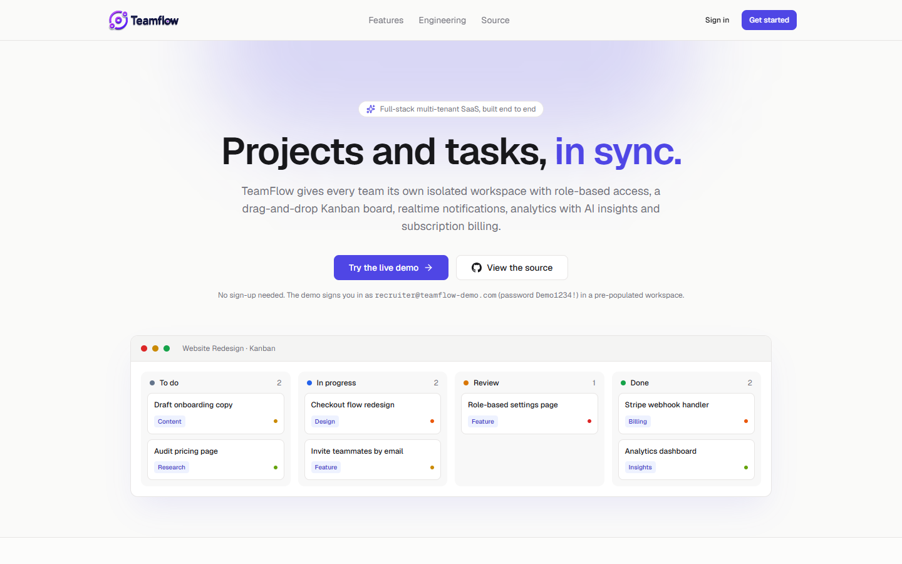
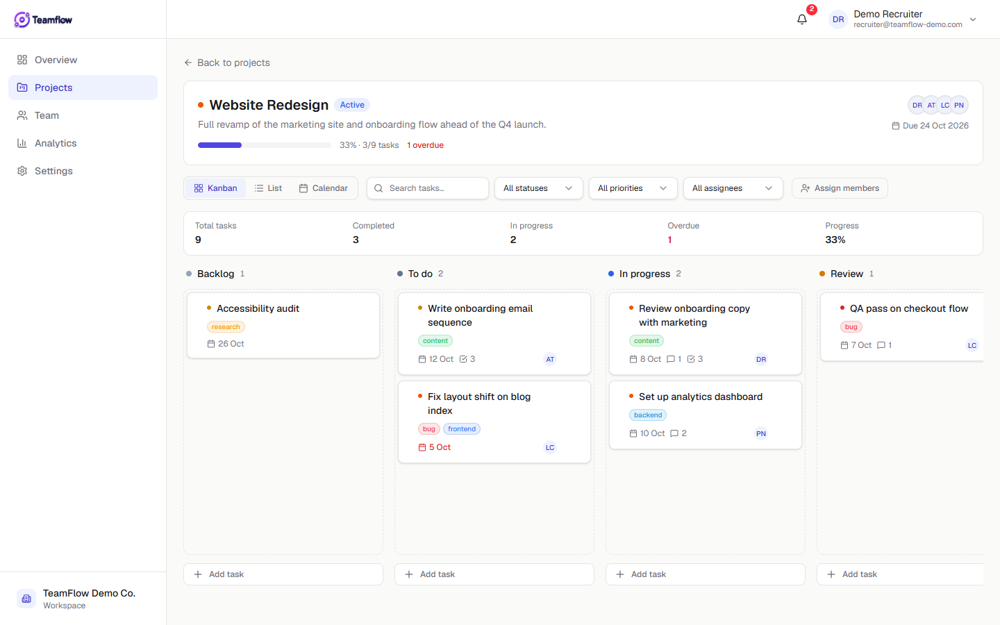
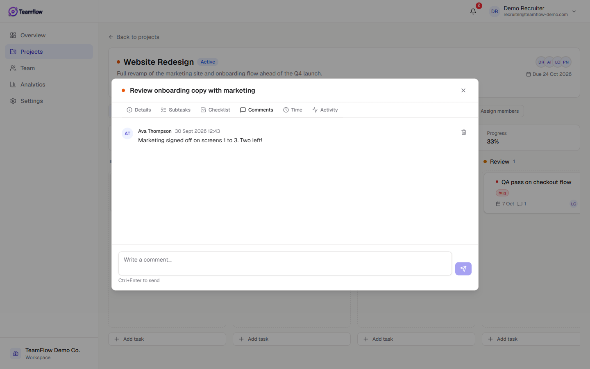
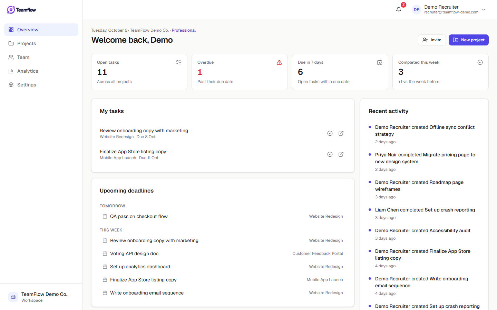
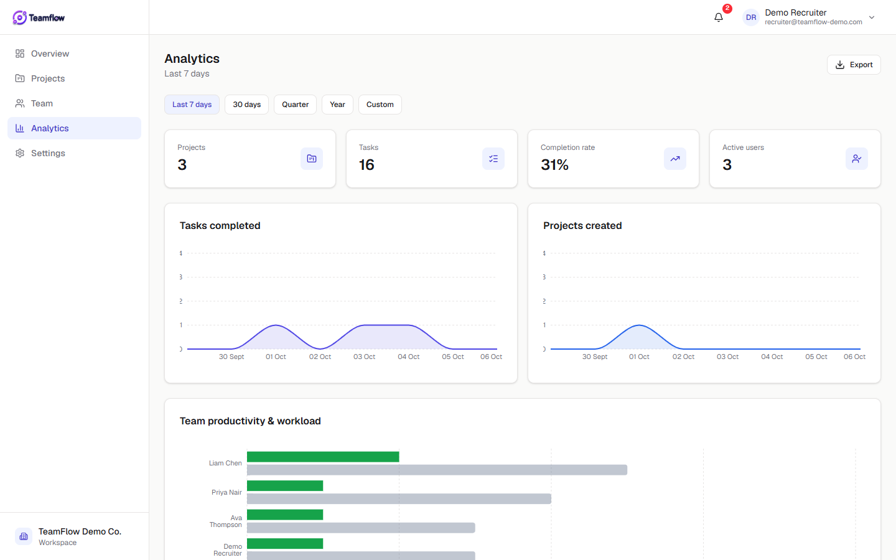
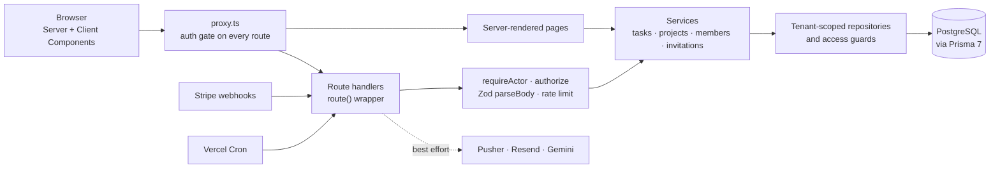

<div align="center">

# TeamFlow

**A multi-tenant project management SaaS: isolated team workspaces, role-based access, a drag-and-drop Kanban board, realtime notifications, analytics with AI insights and Stripe billing.**

[**Live demo**](https://teamflow-rosy-three.vercel.app) · [Features](#features) · [Architecture](#architecture) · [Run locally](#running-locally)

[](https://github.com/De-Junior/Teamflow/actions/workflows/ci.yml)




</div>

## Try it in one click

Open the [live demo](https://teamflow-rosy-three.vercel.app) and press **Try the live demo**. You're signed in to a populated workspace with projects, tasks, teammates and analytics, no sign-up needed.

| Email | Password |
|---|---|
| `recruiter@teamflow-demo.com` | `Demo1234!` |

The demo workspace resets itself every night, so feel free to drag tasks around, comment and create projects. Actions that would break it for the next visitor (deleting the organization, changing the password, emailing invitations) are disabled for this account.

## Features

| | |
|---|---|
| **Dashboard** | What needs attention today: open, overdue and due-soon work, completions against last week, your tasks, deadlines and a readable feed of what the team changed. |
| **Kanban, list and calendar views** | Drag tasks across Backlog → To do → In progress → Review → Done with `dnd-kit`. Moves are optimistic and roll back if the server rejects them. The board also works from the keyboard. |
| **Task detail** | Inline-editable fields, subtasks, checklists with progress, labels, threaded comments, time tracking and a per-task activity log. |
| **Multi-tenancy** | Every organization's data is isolated. A task, comment or label ID from another organization simply resolves to *not found*. |
| **Roles and permissions** | Owner, Manager, Developer and Viewer, driven by a single permission matrix that both the UI and the API read. |
| **Team management** | Email invitations with roles, resend and revoke, member profiles and role changes. |
| **Realtime notifications** | Assignments arrive instantly over authenticated Pusher private channels, with transactional email through Resend. |
| **Analytics** | KPIs, completion trends, team workload and project comparison, plus AI summaries of risks and delays from Google Gemini. |
| **Billing** | Stripe Checkout and customer portal, kept in sync by signed, idempotent webhooks. |
| **Account security** | Rate-limited sign-in and reset, single-use hashed tokens for verification and reset, Google sign-in with account linking, and a device list with remote sign-out. |
| **Polish** | Light, dark and system themes without a flash on load, skeleton loading, empty and error states, toasts instead of browser alerts, and layouts that work down to a 375px phone. |

<table>
  <tr>
    <td></td>
    <td></td>
  </tr>
  <tr>
    <td></td>
    <td></td>
  </tr>
</table>

## Architecture



### Engineering decisions worth a look

**Thin routes, one response shape.** Every handler is wrapped in [`route()`](src/lib/api/handler.ts), which turns thrown errors into one envelope (`{ success, data }` or `{ success: false, code, message, fields? }`), maps Prisma and Zod errors to the right status, tags each response with an `X-Request-Id` and logs unexpected failures as structured JSON. Business rules live in [`src/services`](src/services), so a route is usually three lines: who is asking, what they sent, which service to call. The browser side mirrors this with a small [`api`](src/lib/api-client.ts) client that unwraps `data` or throws one error type, so forms can put a 422 message next to the right field.

**Tenant isolation lives in one place.** Projects and tasks are read and written through repositories in [`src/lib/db/tenant.ts`](src/lib/db/tenant.ts) that inject the tenant filter themselves. Child records such as subtasks, comments and time entries go through [`requireTaskAccess`](src/lib/api/task-access.ts), which proves the parent task belongs to the caller's tenant before anything else runs. Route authors can't forget the filter because they never write it.

**One permission matrix, enforced twice.** [`src/lib/auth/permissions.ts`](src/lib/auth/permissions.ts) maps each role to its permissions. Components use it to decide what to render, and every mutating route checks it again on the server, so hiding a button is never the only line of defence. A unit test asserts that no lower role ever holds a permission a higher role lacks.

**Revocable sessions on top of JWTs.** Credentials sign-in requires JWT sessions in Auth.js, which normally can't be revoked. Each sign-in also writes an `ActiveSession` row whose ID rides in the token. The `jwt` callback re-checks it at most every five minutes, which bounds database load and gives users "sign out other devices".

**Rate limiting without new infrastructure.** Serverless instances don't share memory, so limits are counted in Postgres with a single atomic upsert per check ([`rate-limit.ts`](src/lib/api/rate-limit.ts)). Sign-in, sign-up, password reset, token links, invitations and AI calls are all capped, and a nightly job prunes old windows.

**Tokens that are safe to leak from the database.** Verification and reset links carry a random token, but only its SHA-256 hash is stored, scoped to its purpose, so a verification link can never be used as a reset link. A password reset also signs out every device.

**Completion time is a fact, not a guess.** Tasks record `completedAt` when they move to Done (from the board or the detail view) and clear it when reopened. Analytics and the dashboard use it, so editing an old task doesn't make it look recently finished.

**Side effects can't fail a request.** Email, realtime pushes and email logging are best-effort and logged. Creating a task succeeds even when a provider is down.

**Webhooks are verified and idempotent.** Stripe events are signature-checked and recorded by event ID before processing, so retries are no-ops.

**A public demo that stays clean.** [`src/lib/demo-seed.ts`](src/lib/demo-seed.ts) rebuilds the demo workspace with dates relative to today. It runs from `npm run db:seed` and from a nightly Vercel Cron job, and destructive actions are blocked for the shared demo account.

## Tech stack

| Layer | Choices |
|---|---|
| Framework | Next.js 16 (App Router, Server Components, route handlers), React 19, TypeScript in strict mode |
| Data | PostgreSQL (Neon in production), Prisma 7 with the `pg` driver adapter |
| Auth | Auth.js v5 with credentials and Google OAuth, bcrypt password hashing |
| UI | Tailwind CSS 4, Radix UI primitives, `dnd-kit`, Recharts, lucide icons |
| Validation | Zod schemas shared by forms and API routes |
| Integrations | Stripe, Pusher, Resend with React Email templates, Google Gemini |
| Quality | Vitest unit tests, service-level integration tests against Postgres, ESLint, Prettier, GitHub Actions CI |
| Hosting | Vercel, including Cron for the nightly demo reset |

## Running locally

**Requirements:** Node.js 20.9 or newer and a PostgreSQL database (local, Docker, or a free Neon project).

```bash
git clone https://github.com/De-Junior/Teamflow.git
cd Teamflow
npm install

cp .env.example .env        # set DATABASE_URL, DIRECT_URL and AUTH_SECRET
npm run db:migrate          # create the schema
npm run db:seed             # build the demo workspace
npm run dev                 # http://localhost:3000
```

Only the database URLs and `AUTH_SECRET` are required. Every integration in [`.env.example`](.env.example) is optional and degrades gracefully: without Resend, verification, reset and invitation links are printed to the dev console, and without Pusher, notifications still appear on refresh.

### Scripts

| Command | What it does |
|---|---|
| `npm run dev` | Start the dev server |
| `npm run build` | Generate the Prisma client and build for production |
| `npm test` | Run the unit tests |
| `npm run test:integration` | Run the service tests against `TEST_DATABASE_URL` (a disposable local Postgres; the suite refuses any other host) |
| `npm run lint` / `npm run typecheck` | ESLint and `tsc --noEmit` |
| `npm run db:migrate` | Create and apply a migration in development |
| `npm run db:deploy` | Apply migrations in production |
| `npm run db:seed` | Reset the demo workspace |

Vercel runs `vercel-build`, which applies pending migrations before building, on production deploys only.

## Project structure

```
src/
├── app/
│   ├── (auth)/            login, register, verification, password reset, invitations
│   ├── (dashboard)/       overview, projects, team, analytics, settings, profile
│   ├── api/               route handlers: projects, tasks, members, billing, webhooks, cron…
│   └── page.tsx           public landing page
├── components/            feature folders (tasks, projects, team, analytics…) and ui primitives
├── lib/
│   ├── api/               route wrapper, errors, request parsing, session guards, rate limiting
│   ├── auth/              Auth.js config and the permission matrix
│   ├── db/                Prisma client and tenant-scoped repositories
│   ├── email/             Resend client and React Email templates
│   ├── pusher/            realtime server and client helpers
│   ├── stripe/            billing client and plan mapping
│   └── demo-seed.ts       demo workspace builder
├── services/              business rules: tasks, projects, members, invitations, accounts, dashboard
├── validations/           Zod schemas
└── proxy.ts               middleware: authentication and tenant checks
prisma/                    schema, migrations and the seed entry point
tests/integration/         service tests against a real database
```

## Security notes

- Passwords hashed with bcrypt; email addresses normalised before lookup.
- Every API payload validated with Zod; every mutation permission-checked on the server.
- Tenant-scoped data access, with integration tests proving another organization's tasks, projects and members resolve to *not found*.
- Rate limits on authentication, token links, invitations and AI calls; API callers without a session get a JSON 401.
- Security headers (`X-Frame-Options`, `nosniff`, `Referrer-Policy`, `Permissions-Policy`) on every response.
- Secrets live only in environment variables, and `.env*` files except the template are git-ignored.

**Known gaps:** sign-in doesn't yet require a verified email, and file attachments beyond avatars aren't built. Both are on the roadmap below.

## Roadmap

- Require a verified email at sign-in, with a "resend verification" flow
- File attachments on tasks via object storage
- Playwright end-to-end tests for the Kanban and invitation flows
- Realtime board updates so teammates see moves without refreshing

## Author

Built by **James Junior Hlungwane**, software engineer. Find more of my work on [GitHub](https://github.com/De-Junior).

## License

MIT
